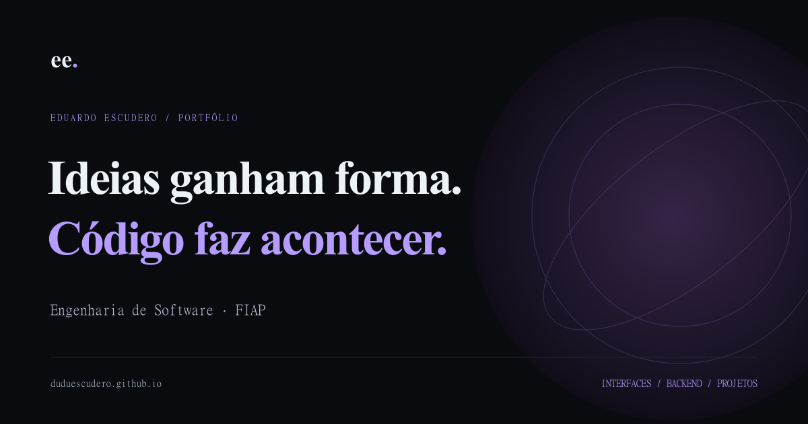

# Eduardo Escudero · Portfólio

**Ideias ganham forma. Código faz acontecer.** Portfólio pessoal com identidade escura e roxa, capturas reais, decisões técnicas e aprendizados.

[](https://github.com/duduescudero/duduescudero.github.io/actions/workflows/pages.yml)

[**Abrir portfólio**](https://duduescudero.github.io/) · [Decisões e manutenção](docs/decisions.md) · [Validação](docs/verification.md)



## O que você encontra

Página inicial, quatro estudos de projeto, galeria ampliada com teclado e restauração do foco, página 404, layout responsivo, fontes locais, imagens WebP, movimento reduzido, contato direto e cópia de e-mail com feedback. Cada página tem metadados próprios; sitemap, robots e imagem social preparam o compartilhamento.

Os projetos apresentados são [Meu Onze](https://github.com/duduescudero/meu-onze), [Fluxo OS](https://github.com/duduescudero/fluxo-os), [OrbitaVerde](https://github.com/duduescudero/orbita-verde) e [PokeIdle Manager](https://github.com/duduescudero/pokeidle-manager). Os textos descrevem o que está implementado e seus limites, incluindo o apoio de IA no desenvolvimento.

## Executar

Requer Node.js 24 ou posterior e npm.

```sh
npm ci
npm run dev
```

Para gerar e conferir a versão estática:

```sh
npm run build
npm run preview
```

Astro com TypeScript, CSS responsivo e fontes Manrope e Space Grotesk hospedadas junto da aplicação. Menu nativo acessível, navegação por âncoras e cópia de contato usam JavaScript mínimo. Não há rastreamento, formulário de envio ou backend.

## Conteúdo

- `src/pages/index.astro`: composição inicial e textos.
- `src/layouts/Base.astro`: estrutura da página e interações.
- `src/styles/global.css`: identidade visual, componentes e ajustes responsivos.
- `public/images/`: capturas de Fluxo OS, OrbitaVerde e PokeIdle Manager, copiadas dos repositórios locais sem alterar os arquivos de origem.
- `.local/`: evidências da revisão, ignoradas pelo Git.

## Testes

```sh
npm run check
npm run build
npx playwright install chromium
npm test
```

As verificações exercitam páginas, links, imagens, galeria, teclado, contato, layout em diferentes larguras e acessibilidade automatizada com axe. Consulte [escopo e limites](docs/verification.md); esses testes não certificam conformidade completa de acessibilidade.

## Atualizar o conteúdo

Os casos de estudo estão em `src/content/projects.ts`. Para adicionar capturas, coloque o PNG em `public/images/` e execute `npm run assets:prepare`, que gera WebP e registra dimensões reais. `scripts/social-card.mjs` gera a imagem de compartilhamento. Mais instruções em [Decisões](docs/decisions.md).

## Publicação

GitHub Actions verifica e publica `dist/` no GitHub Pages. O repositório deve usar GitHub Actions como fonte do Pages. Endereço canônico: **https://duduescudero.github.io/**. `.openai/hosting.json` identifica a cópia privada do Sites, não contém credenciais e não interfere na publicação pública.

## Desenvolvimento e créditos

**Eduardo Escudero** · Engenharia de Software na FIAP.

Desenvolvido com apoio de IA na implementação, revisão, testes e documentação. As capturas usam dados demonstrativos. Fontes Manrope e Space Grotesk distribuídas pelo Fontsource sob SIL Open Font License; veja [créditos](docs/credits.md).

[GitHub](https://github.com/duduescudero) · [E-mail](mailto:eduardoescudero911@gmail.com) · [Licença MIT](LICENSE)
